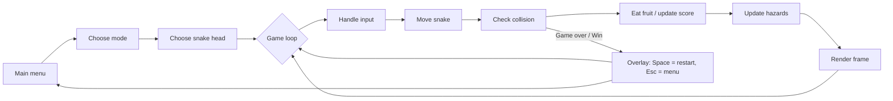

<div align="center">

# 🐍 Hungry Snake
<picture>
  <source media="(prefers-color-scheme: dark)" srcset="https://raw.githubusercontent.com/lehoangminhhuy1203-hash/python-snake-game/output/github-snake-dark.svg" />
  <source media="(prefers-color-scheme: light)" srcset="https://raw.githubusercontent.com/lehoangminhhuy1203-hash/python-snake-game/output/github-snake.svg" />
  
</picture>

**A multi-mode Snake game built with Python & Pygame — four difficulty levels, real-time hazards and a health system.**


*Asian mode — warning markers show where meteors and spike lines are about to strike.*

</div>

---

## 📑 Table of Contents

1. [Overview](#-overview)
2. [Game Modes](#-game-modes)
3. [Installation](#-installation)
4. [Controls](#-controls)
5. [Technical Design](#-technical-design)
6. [Project Structure](#-project-structure)
7. [Learning Outcomes](#-learning-outcomes)
8. [Roadmap](#-roadmap)
9. [Author](#-author)

---

## 📌 Overview

**Hungry Snake** is a course project developed to apply core Python programming knowledge from university coursework — object-oriented design, control flow, data structures and event-driven programming — to a complete, playable application.

Beyond the classic rules, the game adds:

- **4 game modes** with distinct rule sets (board wrapping, wall collision, self-collision, direction reversal).
- **Weighted fruit system** — each fruit type carries a different score, and some fruits change the game speed.
- **Dynamic hazards** (meteors and spike lines) with a warning → impact life cycle.
- **Health points** and a win condition for the hardest mode.
- **Character selection**, background music and sound effects.

## 🎮 Game Modes

| Mode | Board edges | Self-collision | Fruits on board | Special rule | Goal |
|:---|:---:|:---:|:---|:---|:---:|
| 🟢 **Easy** | Wrap-around | ☠️ Game over | Apples, accumulate up to 15 | — | Endless |
| 🟡 **Medium** | ☠️ Walls | Allowed | 15 (apple, watermelon, durian) | Snake **reverses direction** after each fruit | **40 pts** |
| 🔴 **Hard** | ☠️ Walls | ☠️ Game over | 15 (all fruit types) | Sugarcane **doubles the speed** | Endless |
| 🟣 **Asian** | Wrap-around | Allowed | 1 apple | 4 HP, meteors & spikes, speed rises with score, direction reversal | **10 pts** |

<p align="center"><br><sub><i>Hard mode — 15 fruits of different values on the board.</i></sub></p>

### Fruit values

| Fruit | Points | Appears in |
|:---|:---:|:---|
| Apple | 1 | All modes |
| Watermelon | 2 | Medium, Hard |
| Durian | 3 | Medium, Hard |
| Sugarcane | 5 | Hard (speed boost) |

### Hazards (Asian mode)

Hazards are triggered when the snake's head comes within a **Chebyshev distance of 5 cells** of the food, so the player is punished exactly when approaching the goal.

| Hazard | Spawn | Warning | Damage |
|:---|:---|:---:|:---|
| ☄️ **Meteor** | 30–60 random cells within a 31 × 31 area around the head | 1.0 s | 1 HP on impact |
| 🔺 **Spike line** | 3–6 lines growing from a random board edge to the center | 2.0 s | 1 HP every 0.3 s while active (1.5 s) |

## ⚙️ Installation

**Requirements:** Python 3.10 or later.

```bash
# 1. Clone the repository
git clone https://github.com/lehoangminhhuy1203-hash/Python-Snake-Game.git
cd Python-Snake-Game

# 2. (Optional) create a virtual environment
python -m venv .venv
# Windows: .venv\Scripts\activate   |   macOS/Linux: source .venv/bin/activate

# 3. Install dependencies
pip install -r requirements.txt

# 4. Run the game
python snake.py
```

## ⌨️ Controls

| Key | Action |
|:---|:---|
| `↑ ↓ ← →` or `W A S D` | Move the snake |
| `Space` | Restart after Game Over / Victory |
| `Esc` | Return to the main menu |
| Mouse | Navigate menus, choose mode and snake head |

## 🧠 Technical Design

### Game loop

The game follows the classic **input → update → render** loop, running at a variable tick rate (`clock.tick(speed)`) so that difficulty can be adjusted at runtime.



### Key implementation details

- **Grid model.** The 1000 × 700 window is divided into 25 px cells; the snake is a list of cell coordinates where the last element is the head. Moving appends a new head and removes the tail — an O(1) amortized operation per step.
- **Input buffering.** Key presses update a `pending_dir`, applied once per tick, which prevents the snake from reversing into itself when two keys are pressed within one frame.
- **Mode-driven rules.** A single `SnakeGame` class handles all four modes; behaviour (wrapping, collision, scoring, hazards) is selected by the `mode` attribute rather than duplicated code.
- **Hazard state machine.** Each hazard moves through `warn → impact → done`, driven by timestamps from `pygame.time.get_ticks()`, independent of the frame rate.
- **Safe spawning.** Fruits are placed by rejection sampling: a random cell is drawn until it overlaps neither the snake nor another fruit.
- **Graceful asset loading.** Missing images fall back to coloured rectangles, so the game still runs if an asset is absent.

## 📂 Project Structure

```
Python-Snake-Game/
├── snake.py                 # Main game (entry point)
├── requirements.txt         # Python dependencies
├── assets/
│   ├── images/              # Snake head sprites (head_1 … head_4)
│   └── sounds/              # Background music and sound effects
├── docs/
│   └── screenshots/         # Images used in this README
├── legacy/
│   └── snake_game_v1.py     # First prototype (neon-colour version)
├── .gitignore
├── LICENSE
└── README.md
```

## 🎓 Learning Outcomes

Through this project I practised:

- **Object-oriented programming** — encapsulating game state and behaviour in a class.
- **Data structures** — lists for the snake body, dictionaries for fruit and hazard configuration.
- **Event-driven programming** — handling keyboard and mouse events with Pygame.
- **Algorithmic thinking** — grid movement, collision detection, Chebyshev distance and timed state transitions.
- **Software organisation** — separating configuration constants, utilities, game logic and menus.

## 🗺️ Roadmap

- [ ] High-score table saved to a local file
- [ ] Pause menu
- [ ] Split `snake.py` into modules (`config`, `game`, `menu`)
- [ ] Unit tests for movement and collision logic
- [ ] Fruit sprites to replace the coloured fallback tiles

## 👤 Author

**Le Hoang Minh Huy** — Applied Mathematics & Computer Science / Data Science, Saigon University (SGU)

- GitHub: [@lehoangminhhuy1203-hash](https://github.com/lehoangminhhuy1203-hash)
- Email: lehoangminhhuy1203@gmail.com

---

<div align="center">
<sub>Made with 🐍 and Pygame · If you enjoyed this project, consider giving it a ⭐</sub>
</div>
